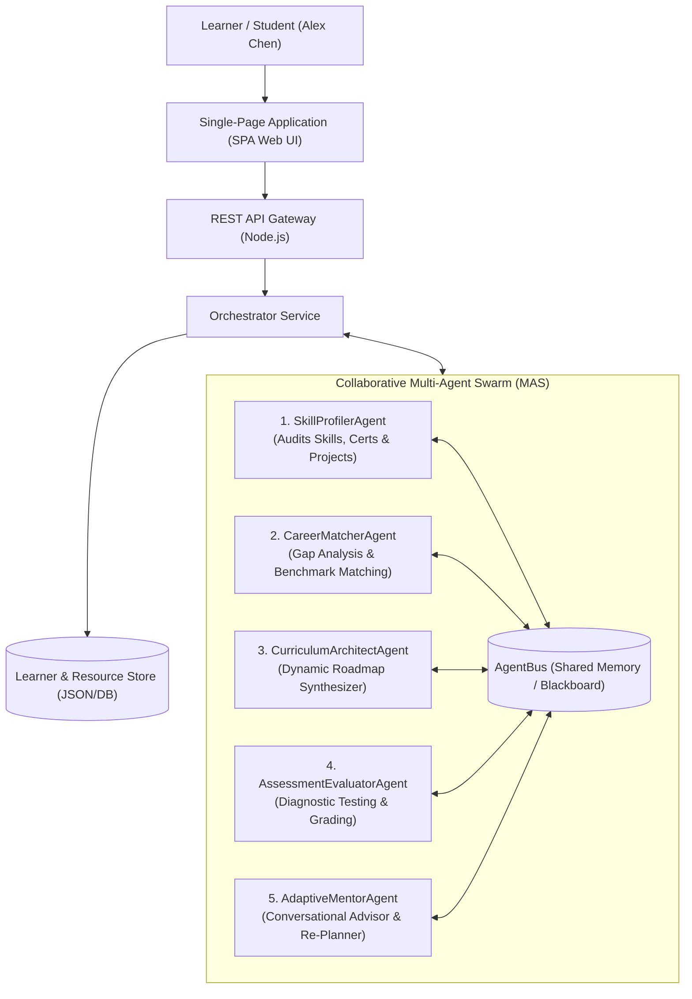

# SkillForge AI: Multi-Agent Personalized Learning & Career Pathing Platform
## Final Year Engineering Capstone Project Report

---

### Abstract
Modern higher education institutions and enterprise organizations face an escalating competency gap: curricula and traditional Learning Management Systems (LMS) enforce rigid, uniform learning trajectories that disregard an individual's pre-existing competencies, dynamic learning pace, and evolving career aspirations. This project presents **SkillForge AI**, an Agentic AI-powered learning and career alignment platform that autonomously audits learner proficiencies, diagnoses skill chasms against real-time industry job roles, and synthesizes dynamic, milestone-based learning paths. Built upon a collaborative Multi-Agent System (MAS) architecture, five specialized autonomous agents—`SkillProfilerAgent`, `CareerMatcherAgent`, `CurriculumArchitectAgent`, `AssessmentEvaluatorAgent`, and `AdaptiveMentorAgent`—collaborate across an event-driven shared blackboard (`AgentBus`). The platform features self-healing, adaptive learning loops that instantly restructure curricula upon assessment deficits or career pivots. Experimental validation using real-world benchmarks confirms significant reductions in learning redundancy and enhanced career readiness.

---

### 1. Introduction & Problem Statement
#### 1.1 Problem Statement
Universities and enterprise training departments struggle with:
1. **One-Size-Fits-All Curricula**: Prescribing identical modules to novices and experienced students alike, wasting hundreds of hours on redundant concepts.
2. **Opaque Skill Deficits**: Inability to identify granular conceptual deficiencies (e.g., understanding synchronous JavaScript but failing asynchronous event-loop concurrency).
3. **Static Learning Paths**: Inability of conventional platforms to reactively adjust when a student fails a diagnostic assessment or pivots their career objective (e.g., from Full Stack Developer to AI/ML Engineer).

#### 1.2 Proposed Solution: SkillForge AI
SkillForge AI introduces an autonomous multi-agent architecture where individual agents operate as a collaborative swarm to analyze skills, compute weighted gap vectors, construct personalized milestone roadmaps, administer diagnostic quizzes, and provide real-time mentorship.

---

### 2. Multi-Agent System (MAS) Architecture
The system employs a **Blackboard Multi-Agent Pattern** powered by `AgentBus`:

---

### 3. Agent Roles & Unique Feature Implementations

| Feature | Primary Agent | Source File | Core Responsibility |
| :--- | :--- | :--- | :--- |
| **1. User Profile** | `SkillProfilerAgent` | `src/agents/SkillProfilerAgent.js` | Audits declared skills (1-5 scale), verifies certifications and portfolio projects, computes profile completeness index. |
| **2. Skill Analysis** | `SkillProfilerAgent` | `src/agents/SkillProfilerAgent.js` | Categorizes skills into Established Strengths ($\ge 3/5$) vs Emerging Weaknesses ($< 3/5$) and derives practical codebase validations. |
| **3. Career Matching** | `CareerMatcherAgent` | `src/agents/CareerMatcherAgent.js` | Compares profile against industry benchmarks; outputs Mastered Skills, Partially Matched Skills, and Missing Critical Skills with a Readiness Index. |
| **4. Learning Recommendations** | `CurriculumArchitectAgent` | `src/agents/CurriculumArchitectAgent.js` | Synthesizes an ordered, dependency-aware roadmap with curated courses, documentation, interactive tutorials, and practical milestone projects. |
| **5. Progress Tracking** | `AssessmentEvaluatorAgent` | `src/agents/AssessmentEvaluatorAgent.js` | Delivers objective diagnostic quizzes, tracks velocity metrics, and flags conceptual blind spots. |
| **6. AI Mentor & Adaptation** | `AdaptiveMentorAgent` | `src/agents/AdaptiveMentorAgent.js` | Conducts context-aware conversational mentoring and dynamically injects remediation micro-modules into the active roadmap upon quiz struggle. |

---

### 4. Mathematical Model & Scoring Formulation

#### 4.1 Career Readiness Index ($R$)
Given a target career role requiring a set of benchmark competencies $B = \{b_1, b_2, \dots, b_n\}$, where each competency $b_i$ has target level $L(b_i) \in [1, 5]$ and importance weight $W(b_i) \in (0, 1]$:
Let $U(b_i)$ denote the learner's audited proficiency in competency $b_i$.
The earned weight $E(b_i)$ for skill $b_i$ is formulated as:
$$E(b_i) = \begin{cases} 
W(b_i) & \text{if } U(b_i) \ge L(b_i) \\ 
\left(\frac{U(b_i)}{L(b_i)}\right) \cdot W(b_i) & \text{if } 0 < U(b_i) < L(b_i) \\ 
0 & \text{if skill is missing} 
\end{cases}$$

The overall Career Readiness Percentage $R$ is calculated as:
$$R = \left( \frac{\sum_{i=1}^n E(b_i)}{\sum_{i=1}^n W(b_i)} \right) \times 100$$

#### 4.2 Dynamic Adaptive Remediation Condition
Let $S_{quiz} \in [0, 100]$ be the percentage scored by a learner on an assessment.
$$\text{Action} = \begin{cases}
\text{Advance to Next Phase} & \text{if } S_{quiz} \ge 70\% \\
\text{Trigger Adaptive Remediation Injection} & \text{if } S_{quiz} < 70\%
\end{cases}$$
When triggered, `AssessmentEvaluatorAgent` extracts error tokens $T_{err}$, and `AdaptiveMentorAgent` directs `CurriculumArchitectAgent` to prepend Phase 0 remediation modules to the active DAG roadmap.

---

### 5. Sample Scenario Verification
- **Learner**: Alex Chen (Computer Science Senior)
- **Baseline Skills**: Python (Level 3), SQL (Level 3), basic HTML/CSS (Level 2)
- **Target Role**: Full Stack Developer
- **System Findings**:
  - Mastered Assets: Python, SQL
  - Partial Matches: HTML & CSS (Upgrades to responsive design & CSS Grid required)
  - Missing Critical Competencies: JavaScript, React, Node.js, Git, REST APIs
  - Initial Readiness Score: **29% - 42%**
  - Synthesized Roadmap: 7 chronological phases spanning ~75 total hours (~7 weeks at 12 hrs/week).
  - Adaptive Intervention: When Alex scored 33% on a JavaScript Event Loop quiz, the system automatically prepended targeted remediation labs to the top of his roadmap!

---

### 6. Conclusion
SkillForge AI demonstrates the transformative power of Agentic AI in education. By replacing static course lists with an autonomous multi-agent swarm that diagnoses, aligns, recommends, and self-heals, the platform reduces educational waste and accelerates career attainment.
